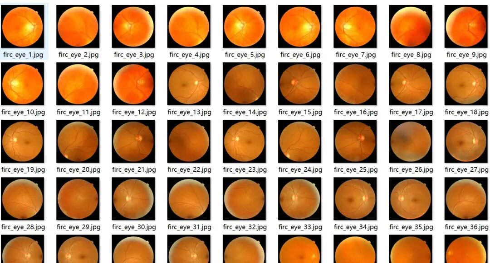
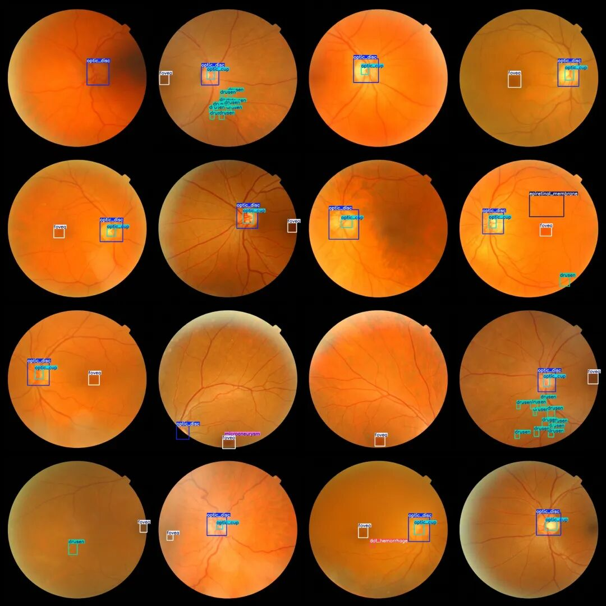
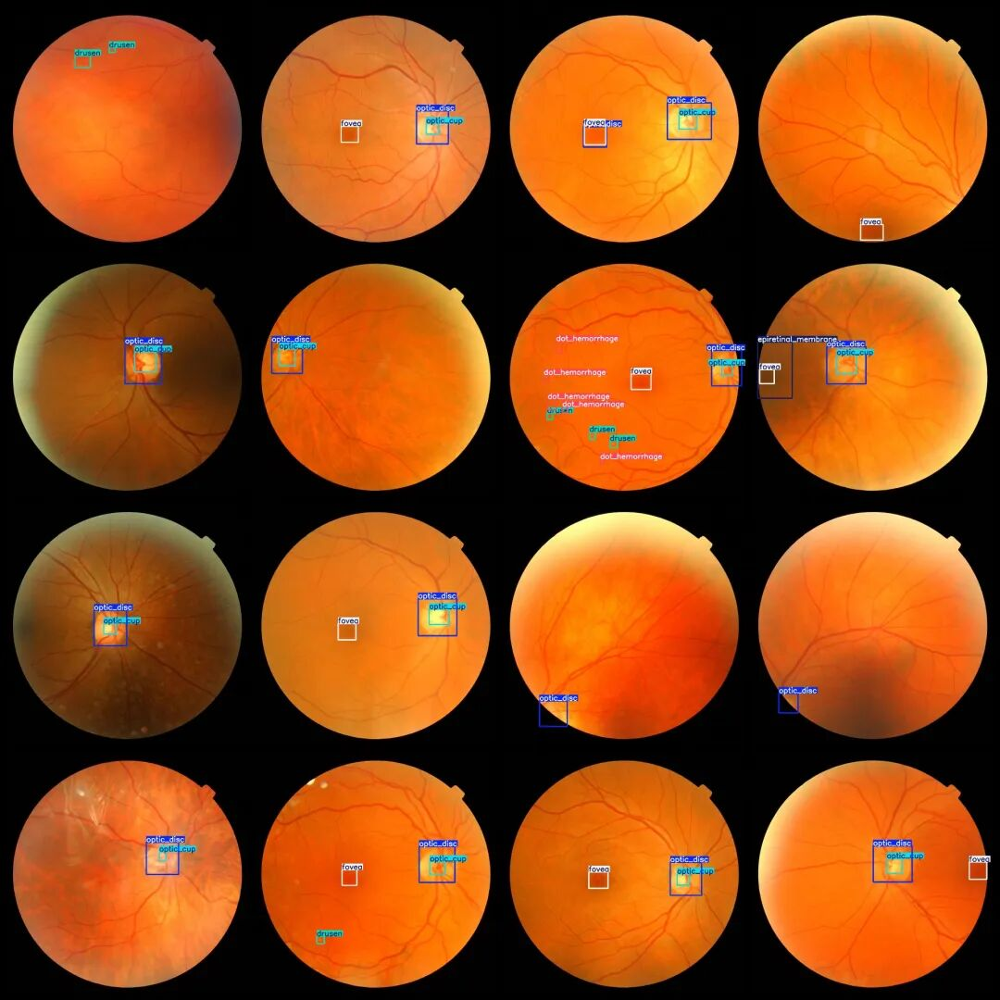

# Intelligent Medical Retina Image Diabetes Retinopathy Detection Dataset VOC+YOLO format with 482 images in 16 categories

Dataset format: Pascal VOC format + YOLO format (txt file without split path, only contains jpg images and corresponding VOC format xml files and yolo format txt files)

Number of images (number of jpg files): 482

Number of annotations (number of xml files): 482

Number of annotations (number of txt files): 482

Annotation category count: 16

Label category names (Note that the order in YOLO format does not correspond to this, but is based on the labels folder's classes.txt): ["artefact", "blot_hemorrhage", "choroidal_nevus", "cotton_wool_spot", "dot_hemorrhage", "drusen", "epiretinal_membrane", "flame_shaped_hemorrhage", "fovea", "hard_exudates", "microaneurysm"]"myelinated_nerve_fibre_layer","optic_cup","optic_disc","pigmentation","roth_spot"]

Number of boxes labeled in each category:

Artefact (artifact) Frames = 25

Blot hemorrhage (spotted bleeding) Frames = 19

choroidal_nevus (choroidal nevus) Frame count = 18

Cotton wool spot (frames = 3)

Dot hemorrhage (spot bleeding) Frames = 159

drusen (glassy papillary tumors) frame count = 278

epiretinal_membrane (retina anterior membrane) frame count = 22

Flame-shaped hemorrhage (7 frames)

fovea (center fovea) frame count = 387

Hard exudates (hard effusion) frame count = 4

Microaneurysm (microaneurysm) Frames = 24

myelinated_nerve_fibre_layer (Number of frames (with myelin sheath) = 5

Optic_cup (optical cup) frame count = 298

Optical Disc (VCR) Frame Count = 356

pigmentation (Pigmentation) Frame count = 8

Roth spot (Roth spot) frame count = 3

Total frames: 1616

Number of images per category:

Artefact (artifact) occupies = 9

Blot hemorrhage (spotted bleeding) occupies 15% of the image.

choroidal_nevus (choroidal nevus) occupies = 16

Cotton wool spot (cotton wool spot) occupies 3% of the image.

Dot hemorrhage (spot bleeding) occupies 51% of the image.

drusen (glassy papillary tumors) occupies = 67

Epiretinal Membrane (Retina Anterior Sheet) occupies = 22

Flame-shaped hemorrhage (flame-shaped bleeding) occupies 7 images.

fovea (center fovea) occupies = 383

hard_exudates (hard exudation) occupies = 2

Microaneurysm (microaneurysm) occupies = 16

Myelinated_nerve_fibre_layer (with myelin sheath) occupies = 4

Optic_cup (optical cup) occupies a picture count = 290

Optical Disc (VCR) occupies 350 images.

pigmentation (Pigmentation) Ownership of the image = 8

Roth spot (Roth spots) occupying the image count = 3

Image resolution: 1000x1000

Using labelImg:

Annotation rules: Draw a rectangle around the category.

Important Notice: The dataset does not have separate training, validation, and test sets; you need to partition them yourself.

Special : This dataset does not guarantee the accuracy of the trained models or weight files.

Image Preview:

Annotation example:

## Payment

Here is a pay link on Stripe ( https://buy.stripe.com/3cs8yP7sY87d0vu9AB ). Please contact me lonlonago@foxmail.com after funding $89, and I will send you a complete data files , thank you!

